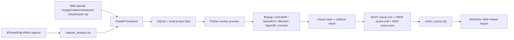

# Real2Motrix

Real2Motrix converts real-world capture data into a local MotrixSim-compatible scene package. It includes:

- `ios/Real2MotrixCapture`: SwiftUI + ARKit capture app source
- `backend`: FastAPI + SQLite backend and plain local Python worker
- `frontend`: Vite React TypeScript B/S management UI with three.js OBJ preview
- `scripts`: dependency checks and macOS install helper

No Docker, no cloud service, no Redis/Celery, no distributed architecture, and no fabricated successful pipeline runs.

## Architecture



## Local Setup

Backend:

```bash
cd backend
python3 -m venv ../.venv
../.venv/bin/pip install -r requirements-dev.txt
../.venv/bin/python -m app.main
```

Worker:

```bash
cd backend
../.venv/bin/python -m app.worker
```

Frontend:

```bash
cd frontend
npm install
npm run dev
```

Open the web UI at `http://localhost:5173`.

## Native Dependencies

Check current machine state:

```bash
python3 scripts/check_dependencies.py
```

Install Homebrew-provided tools:

```bash
scripts/install_macos_deps.sh
```

Required by source type:

- Mesh inputs: Python backend deps and `trimesh`; FBX conversion additionally requires Blender.
- Point clouds: Open3D installed in the backend environment with `../.venv/bin/pip install -r requirements-pipeline.txt`.
- Video: `ffmpeg`, then the image reconstruction requirements.
- Images and normal iOS capture reconstruction: `COLMAP` and OpenMVS executables on PATH.
- iOS app build/run: full Xcode selected with `sudo xcode-select -s /Applications/Xcode.app/Contents/Developer`.
- iOS project generation: `xcodegen`, installed with `brew install xcodegen`.

If a required dependency is missing, the job fails with a clear log entry. The worker does not create placeholder meshes or mark a skipped reconstruction as successful.

## API

Implemented endpoints:

- `POST /api/projects`
- `GET /api/projects`
- `GET /api/projects/{project_id}`
- `DELETE /api/projects/{project_id}`
- `POST /api/projects/{project_id}/upload`
- `POST /api/projects/{project_id}/capture-sessions`
- `POST /api/projects/{project_id}/run`
- `GET /api/jobs/{job_id}`
- `GET /api/jobs/{job_id}/logs`
- `GET /api/projects/{project_id}/assets`
- `GET /api/projects/{project_id}/download`
- `GET /api/projects/{project_id}/preview/visual`
- `GET /api/projects/{project_id}/preview/collision`
- `POST /api/projects/{project_id}/validate`
- `GET /api/projects/{project_id}/files/{path}`
- `GET /api/health`

## iOS Capture

The capture app source lives in `ios/Real2MotrixCapture/Sources/Real2MotrixCapture`.

The app records:

- RGB frames as JPEG
- Camera intrinsics
- ARKit camera poses in meters
- Timestamps
- Device and capture metadata
- Depth PNGs when `sceneDepth` is available
- ARMeshAnchor OBJ when scene reconstruction is available
- Quality report with brightness, blur, tracking, movement, coverage, and warnings

`project.yml` is provided for XcodeGen users:

```bash
cd ios/Real2MotrixCapture
xcodegen generate
open Real2MotrixCapture.xcodeproj
```

Run on a real iPhone/iPad. Simulator validation is not sufficient for ARKit capture, LiDAR, depth, or local network upload.

## Input Workflows

iPhone capture to MotrixSim:

1. Start backend, worker, and frontend.
2. In the iOS app, enter the backend LAN URL, test connection, create/select a project.
3. Capture RGB/pose/depth data and generate `capture_session.zip`.
4. Upload from the app; it calls `POST /api/projects/{project_id}/capture-sessions`.
5. Worker reconstructs through COLMAP/OpenMVS and exports Motrix files.
6. Download `motrix_scene.zip` from the web UI.
7. Unzip and drag the whole `motrix_scene` folder into MotrixSim Web Viewer.
8. Load `scene.xml`, `scene.urdf`, or `scene.json`.

Video to MotrixSim:

1. Create a project in the web UI.
2. Choose `video`, upload a real video file, then start the pipeline.
3. Worker extracts frames with `ffmpeg`, reconstructs with COLMAP/OpenMVS, cleans meshes, validates, and packages.

Mesh to MotrixSim:

1. Choose `mesh`, upload OBJ/GLB/GLTF/STL/FBX/PLY mesh.
2. Worker converts to OBJ when needed, cleans/aligned units, creates a lower-face collision mesh, writes Motrix files, validates, and zips.

Point cloud to MotrixSim:

1. Choose `pointcloud`, upload PLY/PCD.
2. Worker uses Open3D Poisson reconstruction before the shared mesh pipeline.

## Output Package

Generated package:

```text
outputs/{project_id}/motrix_scene/
  scene.xml
  scene.urdf
  scene.json
  meshes/
    scene_visual.obj
    scene_collision.obj
    objects/
      object_001/
        visual.obj
        collision.obj
  textures/
  metadata/
    asset_manifest.json
    scene_manifest.json
    object_manifest.json
    semantic.json
    reconstruction_report.json
    validation_report.json
  raw/
    source_info.json
  README.md
```

`scene_visual.obj` / `scene_collision.obj` remain the static environment entry for compatibility. When separable geometry is found, object candidates are exported under `meshes/objects/{object_id}/` and referenced from `scene.xml`, `scene.urdf`, `scene.json`, and `metadata/asset_manifest.json`.

Validation checks XML/JSON parseability, relative paths, scene/object mesh existence, mesh loadability, bbox sanity, asset manifest presence, object count, and scene collision face count lower than visual face count.

## Tests

Backend:

```bash
cd backend
../.venv/bin/python -m pytest
```

Frontend:

```bash
cd frontend
npm test
npm run build
```

Current machine note: Swift CLI is installed, but `xcodebuild` points to CommandLineTools, so iOS build/run cannot be verified until full Xcode is selected.
