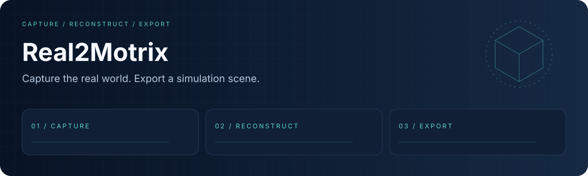
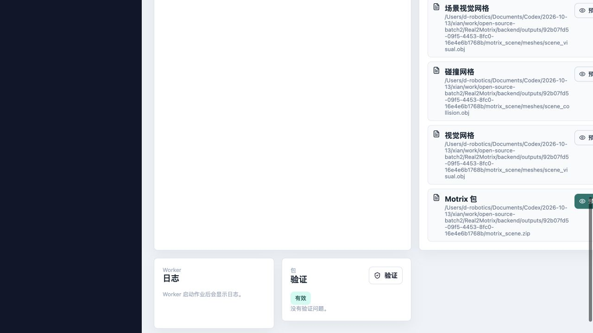

<div align="center">
  
  <h1>Real2Motrix</h1>
  <p><strong>从真实采集到可验证的仿真场景包。</strong></p>
  <p><a href="LICENSE"></a> <a href="docs/readme/validation.md"></a></p>
  <p><a href="#overview">项目亮点</a> · <a href="#quick-start">快速开始</a> · <a href="#workflow">工作流</a> · <a href="#validation">验证</a> · <a href="#documentation">文档</a></p>
  <p><a href="README.md">English</a> · <a href="README.zh-CN.md">简体中文</a></p>
</div>

---

<a id="overview"></a>
## 项目亮点

本地 ARKit 采集、网格处理与 MJCF / URDF 场景包工具链。先运行自产合成网格，再按输入类型安装重建工具。

**当前为本地 Alpha 版本。** 手机采集属于实验能力；轨迹网格覆盖率不等于表面扫描完整度。
当前没有 3DGS 训练与渲染流水线，也不是可直接部署的生产扫描服务。
验收标准见[路线图](docs/ROADMAP.md)，联网使用前请阅读[安全说明](SECURITY.md)。

| 能力 | 内容 |
| :--- | :--- |
| **原生采集** | SwiftUI / ARKit 源码；真机使用需要 Xcode 和签名。 |
| **本地处理** | FastAPI、SQLite 与独立 Python worker。 |
| **场景导出** | 视觉/碰撞网格、MJCF、URDF、元数据和 ZIP 校验。 |

### 本地演示



*自产网格通过本机 API/worker 完成导出与场景包校验。*

<a id="quick-start"></a>
## 快速开始

验证环境为 Python 3.12、Node 24。合成网格演示不依赖 COLMAP / OpenMVS。

```bash
git clone https://github.com/eust-w/Real2Motrix.git
cd Real2Motrix
python3.12 -m venv .venv
source .venv/bin/activate
python -m pip install -r backend/requirements-dev.txt
python scripts/synthetic_demo.py
```

<a id="workflow"></a>
## 工作流

```text
CAPTURE → RECONSTRUCT → EXPORT
```

```bash
# In separate terminals, with the virtual environment active:
cd backend && python -m app.main
cd backend && python -m app.worker
cd frontend && npm ci && npm run dev
```

<a id="validation"></a>
## 验证

```bash
cd backend && ../.venv/bin/python -m pytest
cd ../frontend && npm test && npm run build
```

运行环境与已执行结果见 [validation notes](docs/readme/validation.md).

| 项目 | 当前边界 |
| :--- | :--- |
| 合成网格 | 内置示例生成原创几何并校验 XML / URDF / JSON / ZIP。 |
| 重建 | COLMAP / OpenMVS / Blender / Open3D 为按需原生依赖；替身命令测试不代表真实重建。 |
| iOS | 真机采集、签名和 TestFlight 属于独立验收。 |

<a id="documentation"></a>
## 文档

- [Pipeline / 流水线](backend/app/pipeline/full_pipeline.py)
- [Backend tests / 后端测试](backend/tests/)
- [iOS release / iOS 发布](docs/ios-release.md)
- [贡献指南](CONTRIBUTING.md)
- [路线图与已知限制](docs/ROADMAP.md)
- [介绍视频与验证证据](docs/launch/README.md)

## 许可证与来源

原创代码和新增演示资源采用 [Apache-2.0](LICENSE). 第三方代码、模型、数据和外部资源保留各自许可，详见 [THIRD_PARTY_NOTICES.md](THIRD_PARTY_NOTICES.md).
